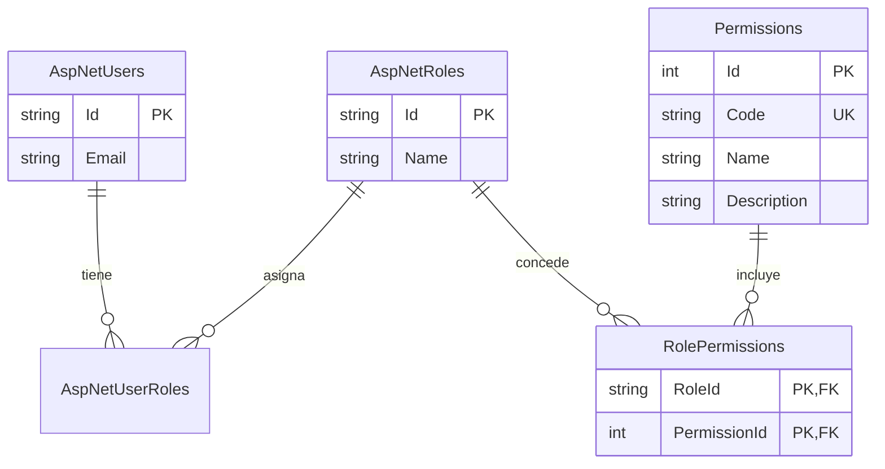

# ExamenPrueba

Aplicación demostrable de administración de identidades y autorización granular. Es un monolito modular en .NET 10 con Blazor Web App, ASP.NET Core Identity, EF Core y SQLite. Incluye registro e inicio/cierre de sesión, CRUD de usuarios, roles y permisos, relaciones Usuario–Rol y Rol–Permiso, autorización dinámica desde SQLite, antiforgery y rate limiting configurable. El alcance de las entregas y las reglas de trabajo están en [AGENTS.md](AGENTS.md).

## Requisitos y arranque local

- SDK .NET 10 y Python 3 para las pruebas end-to-end.
- Certificado de desarrollo HTTPS instalado. Verificarlo con `dotnet dev-certs https --check --verbose`; el proyecto no modifica certificados del sistema.

Desde la raíz del repositorio, en la terminal de VS Code:

```powershell
dotnet restore ExamenPrueba.sln
dotnet tool restore
dotnet build ExamenPrueba.sln
dotnet run --project ExamenPrueba --launch-profile https
```

Abrir `https://localhost:7205`. El perfil también escucha en `http://localhost:5080` y redirige a HTTPS. Si los puertos están ocupados, consultar `ExamenPrueba/Properties/launchSettings.json`. El certificado de desarrollo debe ser confiable en el navegador usado para la prueba.

## Base de datos y migraciones

`DefaultConnection` usa `ExamenPrueba/Data/app.db` cuando la aplicación se ejecuta desde el proyecto servidor. La aplicación aplica las migraciones al iniciar. También se pueden aplicar manualmente desde `ExamenPrueba` con `dotnet dotnet-ef database update` después de `dotnet tool restore`.

Las migraciones son `00000000000000_CreateIdentitySchema` y `20261106232734_AddRoleBasedPermissions`. La segunda solo agrega `Permissions`, `RolePermissions`, sus claves, relaciones e índices. Conserva todas las tablas originales de Identity, incluida `AspNetUserPasskeys`. En una base existente, crear primero un respaldo consistente de SQLite y comprobar las migraciones pendientes. La base y sus respaldos `*.db` están excluidos de Git.

## Arquitectura

La solución mantiene tres capas dentro de un único proceso y un único origen HTTPS:

- **Presentación:** `Components`, `ExamenPrueba.Client` y `Presentation/Api`. Blazor presenta las pantallas y consume Minimal APIs; las páginas Razor de Identity procesan registro, login, logout y administración de la cuenta.
- **Aplicación:** `Application` contiene contratos, DTOs, servicios, validaciones y reglas de seguridad. Las páginas no acceden a EF Core de forma directa.
- **Infraestructura:** `Infrastructure` integra Identity, EF Core, SQLite, inicialización RBAC, autorización y rate limiting.

Una solicitud administrativa sigue este recorrido: navegador Blazor → endpoint HTTPS → autenticación por cookie → rate limiter → política de autorización → validación antiforgery en mutaciones → servicio de aplicación → Identity/EF Core → SQLite. El backend vuelve a resolver los permisos efectivos desde las relaciones actuales de SQLite en cada solicitud; ocultar un control en Blazor solo mejora la interfaz y nunca sustituye la autorización del endpoint.

### Modelo relacional

Identity proporciona usuarios, roles y la tabla de unión Usuario–Rol. La aplicación agrega el catálogo `Permissions` y la unión `RolePermissions`, cuya clave compuesta impide duplicados.



## Cuentas y prueba manual de E1

1. En `https://localhost:7205/Account/Register`, registrar una cuenta. El servidor asigna exclusivamente `User`, sin aceptar un rol enviado desde el formulario.
2. Abrir el vínculo de confirmación que muestra la página `RegisterConfirmation` en Development. La plantilla usa un emisor de correo simulado; no envía correo real.
3. Iniciar sesión en `/Account/Login`. Abrir `/dashboard`: debe mostrar correo, rol `User`, ausencia de permisos administrativos y el mensaje de acceso denegado para el resumen. La página hace solicitudes HTTP del navegador a `/api/auth/me`, `/api/security/capabilities` y `/api/admin/overview`; se pueden observar en la pestaña Network de las herramientas del navegador.
4. Abrir `/Account/Manage` para verificar una página protegida. Cerrar sesión desde el menú de cuenta. Sin sesión, `/dashboard` conduce a login y las tres APIs devuelven HTTP 401.

Para crear **una cuenta Admin de prueba exclusivamente en Development**, configurar User Secrets fuera del repositorio desde la raíz (sustituir los marcadores por un correo y una contraseña propios, sin guardarlos en archivos versionados):

```powershell
dotnet user-secrets set "AdminBootstrap:Enabled" "true" --project ExamenPrueba
dotnet user-secrets set "AdminBootstrap:Email" "<correo-admin-de-prueba>" --project ExamenPrueba
dotnet user-secrets set "AdminBootstrap:Password" "<contraseña-de-prueba>" --project ExamenPrueba
dotnet run --project ExamenPrueba --launch-profile https
```

El bootstrap se ejecuta solo si `AdminBootstrap:Enabled` es `true` y el entorno es Development. Crea una cuenta nueva confirmada con rol `Admin`; si el correo ya pertenece a una cuenta sin ese rol, detiene el arranque y no la eleva. Es idempotente. Después de crearla, detener el servidor y desactivar el bootstrap:

```powershell
dotnet user-secrets set "AdminBootstrap:Enabled" "false" --project ExamenPrueba
```

Reiniciar y acceder con esa cuenta. `/dashboard` debe mostrar los doce permisos y el resumen administrativo. El servidor consulta SQLite para resolver cada permiso efectivo; el navegador no decide el acceso. El bootstrap es para desarrollo local. E2 administra usuarios, E3 administra roles y asignaciones Usuario–Rol, y E4 administra permisos personalizados y asignaciones Rol–Permiso.

## Autenticación, APIs de sesión y rate limiting

| Ruta | Acceso | Resultado esperado |
| --- | --- | --- |
| `GET /api/auth/me` | Usuario autenticado | Id, correo y roles; anónimo: 401. |
| `GET /api/auth/antiforgery` | Público | Emite cookie y token antiforgery; `Cache-Control: no-store`. |
| `POST /api/auth/register` | Público + antiforgery + límite de registro | Crea una cuenta sin confirmar y asigna exclusivamente `User`. |
| `POST /api/auth/login` | Público + antiforgery + límite de login | Valida cuenta confirmada y emite cookie Identity. |
| `POST /api/auth/logout` | Autenticado + antiforgery | Invalida la cookie y devuelve 204. |
| `GET /api/security/capabilities` | Usuario autenticado | Códigos de permisos efectivos; anónimo: 401. |
| `GET /api/admin/overview` | Permiso `users.read` | Resumen sin datos sensibles; anónimo: 401; sin permiso: 403. |

E5.1 alinea la autenticación con el requisito de API sin duplicar el modelo de seguridad. Los formularios existentes de registro, login y logout interceptan el submit mediante `fetch`, obtienen o reutilizan un token antiforgery, llaman a `/api/auth/*` con `credentials: same-origin` y navegan tras la respuesta. El POST server-side permanece como fallback sin JavaScript, pero ambos caminos usan `IAccountAuthenticationService`; el registro delega además en el mismo `IUserService` que conserva transacción, validaciones, confirmación y rol `User`.

No se habilita `MapIdentityApi`: además de mapear más operaciones de las requeridas, su registro estándar crea el usuario pero no aplica la asignación exclusiva de `User`, y su login puede seleccionar autenticación bearer cuando no se fuerzan cookies. Los endpoints específicos del proyecto exponen solo cookies Identity y los tres flujos solicitados. Para un cliente JSON, el orden es: obtener `GET /api/auth/antiforgery`, enviar el token en `X-CSRF-TOKEN`, conservar la cookie antiforgery y, después del login, conservar también la cookie de sesión.

Las cuatro políticas usan ventana fija y `QueueLimit = 0`; se configuran bajo `RateLimiting` en `ExamenPrueba/appsettings.json` y se validan al arrancar. Los cambios se aplican al reiniciar, no en tiempo real.

| Política | Operación real | Límite normal | Partición |
| --- | --- | --- | --- |
| Login | `POST /Account/Login` y `POST /api/auth/login` | 5 por 60 segundos compartidos | IP de la conexión |
| Registro | `POST /Account/Register` y `POST /api/auth/register` | 3 por 600 segundos compartidos | IP de la conexión |
| Lectura administrativa | GET de usuarios, roles, permisos y sus dos matrices | 60 por 60 segundos | Id estable del usuario |
| Mutación administrativa | POST, PUT y DELETE de los CRUD y relaciones RBAC | 20 por 60 segundos | Id estable del usuario |

El middleware responde 429. Cuando el limitador proporciona metadatos válidos, envía `Retry-After`; las APIs reciben un `ProblemDetails` JSON genérico y los formularios Identity un texto genérico. Una solicitud puede recibir 429 antes de autorización, antiforgery o validación porque el limitador se ejecuta después de autenticación y antes de autorización. `GET` de formularios, recursos estáticos, navegación Blazor y APIs de sesión/antiforgery no consumen los contadores administrativos.

Para tráfico público se usa exclusivamente `HttpContext.Connection.RemoteIpAddress`: una cabecera `X-Forwarded-For` enviada por un cliente no cambia la partición. En un despliegue tras proxy inverso se deben configurar proxies/redes confiables y `ForwardedHeaders` antes del limitador; no debe confiarse globalmente en esa cabecera. Usuarios tras el mismo NAT comparten contador público. Los contadores viven en memoria y son independientes por instancia; esta entrega no agrega almacenamiento distribuido.

## CRUD de usuarios (E2)

| Método y ruta | Permiso | Respuesta principal |
| --- | --- | --- |
| `GET /api/users?page=1&pageSize=10&search=` | `users.read` | 200: lista paginada, total y roles de consulta. Máximo 50 por página. |
| `GET /api/users/{id}` | `users.read` | 200: detalle seguro; 404 si falta. |
| `POST /api/users` | `users.create` | 201: usuario nuevo con rol `User`, correo sin confirmar; 400/409 para datos inválidos o duplicados. |
| `PUT /api/users/{id}` | `users.update` | 200: correo actualizado; requiere reconfirmación si cambió; 400/404/409 según el caso. |
| `DELETE /api/users/{id}` | `users.delete` | 204: eliminación física; 404 si falta y 409 para cuenta propia o último Admin. |

Las respuestas solo exponen Id, correo, confirmación y roles. POST acepta `email`, `password` y `confirmPassword`; PUT acepta únicamente `email`. Los campos adicionales se rechazan. Identity valida contraseñas y unicidad de correo. El alta y la edición generan un vínculo de confirmación a partir de `Application:PublicOrigin` (por defecto `https://localhost:7205`); al cambiar de puerto, configurar ese valor con el origen HTTPS real. La plantilla aún usa un emisor de correo simulado. En Development, abrir `/Account/RegisterConfirmation?email=<correo>` para obtener el vínculo de confirmación.

Las tres mutaciones requieren un token antiforgery además de la cookie y el permiso. La página `/users` obtiene `GET /api/security/antiforgery` y envía el token en `X-CSRF-TOKEN` con credenciales del mismo origen. Una solicitud sin token o con token inválido recibe 400. La protección de formularios de Identity permanece activa. No hay CORS abierto.

### Prueba manual en VS Code

1. Ejecutar los comandos de «Requisitos y arranque local» anteriores y entrar como Admin de Development. Abrir `https://localhost:7205/users`.
2. Pulsar **Crear usuario**, introducir un correo y una contraseña de prueba, y guardar. Confirmar que la tabla muestra el rol `User` y «Confirmado: No». Crear de nuevo con el mismo correo para comprobar el mensaje de conflicto.
3. Pulsar **Detalle**; comprobar Id, correo, confirmación y roles. Buscar el correo. Con más de diez usuarios de prueba, usar **Anterior** y **Siguiente**.
4. Pulsar **Editar**, cambiar el correo y guardar. Debe seguir sin confirmar. En Development, abrir `/Account/RegisterConfirmation?email=<correo-nuevo>` y seguir el vínculo simulado para confirmarlo.
5. Pulsar **Eliminar** sobre esa cuenta de prueba, aceptar el diálogo y comprobar que desaparece. No usar la cuenta Admin principal para una prueba destructiva. La API rechaza la autoeliminación y la eliminación del último Admin.
6. Cerrar sesión: `/users` conduce a login y las APIs devuelven 401. Con una cuenta `User`, `/users` muestra acceso denegado y las APIs del CRUD devuelven 403.

## CRUD de roles y asignaciones Usuario–Rol (E3)

| Método y ruta | Permiso | Respuesta principal |
| --- | --- | --- |
| `GET /api/roles?page=1&pageSize=10&search=` | `roles.read` | 200: lista paginada con tipo protegido y número de usuarios. Máximo 50 por página. |
| `GET /api/roles/{id}` | `roles.read` | 200: detalle; 404 si falta. |
| `POST /api/roles` | `roles.create` | 201: rol personalizado; 400/409 para nombre inválido, reservado o duplicado. |
| `PUT /api/roles/{id}` | `roles.update` | 200: rol renombrado; 400/404/409 según el caso. |
| `DELETE /api/roles/{id}` | `roles.delete` | 204: eliminación; 409 si está protegido, tiene usuarios o conserva relaciones con permisos. |
| `GET /api/users/{userId}/roles` | `users.read` **y** `roles.read` | 200: todos los roles con su estado de asignación; 404 si falta el usuario. |
| `POST /api/users/{userId}/roles/{roleId}` | `users.update` **y** `roles.update` | 200: asignación actualizada; 404/409 según el caso. |
| `DELETE /api/users/{userId}/roles/{roleId}` | `users.update` **y** `roles.update` | 200: asignación actualizada; 404/409 según el caso. |

Los nombres admiten hasta 64 caracteres y solo letras, números, punto, guion y guion bajo. `Admin` y `User` se comparan normalizados y son reservados: no se pueden recrear con variantes de mayúsculas, renombrar ni eliminar. Antes de borrar un rol personalizado, el servidor comprueba asignaciones Usuario–Rol y Rol–Permiso sin eliminar relaciones de forma implícita.

Las mutaciones requieren `X-CSRF-TOKEN`. Para asignar o revocar `Admin`, el operador debe seguir perteneciendo a `Admin` en la base de datos en ese momento. No puede autoasignarse ni revocarse su propio rol Admin, y no puede dejar al sistema sin administradores. La comprobación de autorización consulta las asignaciones y permisos actuales de SQLite en cada petición, por lo que una concesión o revocación surte efecto en la siguiente solicitud HTTP sin cerrar sesión.

### Prueba manual de E3

1. Iniciar como Admin de Development y abrir `https://localhost:7205/roles`. Comprobar que `Admin` y `User` aparecen como protegidos y no ofrecen edición ni eliminación.
2. Crear un rol personalizado, buscarlo, abrir su detalle y renombrarlo. Probar un nombre duplicado y una variante de `Admin`; deben rechazarse.
3. Abrir `/users`, mostrar el detalle de una cuenta de prueba y asignar/revocar el rol personalizado. La tabla y el detalle deben actualizarse sin un nuevo login.
4. Intentar eliminar un rol todavía asignado: debe responder 409. Revocarlo, eliminarlo y comprobar 204. No usar cuentas ni roles de producción para estas pruebas.
5. Con una cuenta sin permisos administrativos, comprobar 403. Sin sesión, comprobar 401. Para probar permisos parciales, usar una base temporal y verificar que la consulta requiere ambos permisos de lectura y la mutación ambos permisos de actualización.
6. No usar la interfaz para alterar el rol Admin de la propia cuenta. Las pruebas automatizadas cubren autoelevación, autorrevocación, operador Admin vigente y continuidad del último administrador sobre una base temporal aislada.

## CRUD de permisos y matriz Rol–Permiso (E4)

| Método y ruta | Protección | Respuesta principal |
| --- | --- | --- |
| `GET /api/permissions?page=1&pageSize=10&search=` | `permissions.read` | 200: catálogo paginado con tipo y número de roles. Máximo 50 por página. |
| `GET /api/permissions/{id}` | `permissions.read` | 200: detalle seguro; 404 si falta. |
| `POST /api/permissions` | `permissions.create` + antiforgery | 201: permiso personalizado sin asignaciones. |
| `PUT /api/permissions/{id}` | `permissions.update` + antiforgery | 200: nombre y descripción actualizados; el código permanece inmutable. |
| `DELETE /api/permissions/{id}` | `permissions.delete` + antiforgery | 204; 409 si es de sistema o conserva relaciones con roles. |
| `GET /api/roles/{roleId}/permissions` | `roles.read` **y** `permissions.read` | 200: todos los permisos con su estado, protección y disponibilidad. |
| `POST /api/roles/{roleId}/permissions/{permissionId}` | `roles.update` **y** `permissions.update`, Admin vigente y antiforgery | 200: matriz actualizada. |
| `DELETE /api/roles/{roleId}/permissions/{permissionId}` | `roles.update` **y** `permissions.update`, Admin vigente y antiforgery | 200: matriz actualizada. |

Los códigos personalizados se normalizan a minúsculas y deben usar al menos dos segmentos alfanuméricos separados por punto, por ejemplo `reports.read`. Son únicos, tienen hasta 128 caracteres y no se pueden cambiar después del alta. El nombre admite 200 caracteres y la descripción opcional 500. La creación de un permiso no lo asigna a ningún rol.

Los doce códigos de `PermissionCodes.All` son permisos de sistema: se pueden consultar y asignar a roles personalizados, pero no editar ni eliminar. `Admin` conserva sus doce permisos esenciales y la API no permite revocarlos. El rol público `User` no puede recibir directamente permisos administrativos del sistema; las capacidades limitadas se otorgan mediante roles personalizados. El inicializador repone únicamente los permisos esenciales de Admin y no restaura asignaciones eliminadas de roles personalizados.

Un permiso personalizado aparece en las capacidades efectivas al asignarlo, pero **no protege automáticamente un endpoint**. Para autorizar una nueva API, el backend debe declarar una política o requisito que use explícitamente ese código. La resolución efectiva sigue consultando SQLite en cada petición, por lo que las concesiones y revocaciones surten efecto sin iniciar sesión de nuevo.

### Prueba manual de E4

1. Iniciar como Admin de Development y abrir `https://localhost:7205/permissions`. Comprobar que los doce permisos base aparecen como “Sistema” y solo ofrecen detalle.
2. Crear `reports.read`, consultarlo, buscarlo y editar nombre y descripción. Confirmar que el código no cambia.
3. Abrir `/roles`, seleccionar un rol personalizado y usar la matriz para asignar y revocar `reports.read`. La casilla debe actualizarse inmediatamente.
4. Asignar temporalmente `users.read` a un rol personalizado que ya tenga un usuario de prueba. Con la sesión existente de ese usuario, `/api/users` debe cambiar de 403 a 200; al revocar, debe volver a 403.
5. Comprobar que los permisos base de Admin tienen casillas bloqueadas y que el rol User no permite recibir los doce permisos administrativos.
6. Revocar `reports.read` de todos los roles y eliminarlo desde `/permissions`. Si aún tiene relaciones, la API debe responder 409. Usar únicamente datos locales de prueba.

## Verificación automatizada

Después de compilar, desde la raíz:

```powershell
dotnet test ExamenPrueba.sln
python tests/e1_smoke.py
python tests/e2_users_smoke.py
python tests/e3_roles_smoke.py
python tests/e4_permissions_smoke.py
python tests/e5_rate_limiting_smoke.py
python tests/e51_auth_api_smoke.py
```

`ExamenPrueba.Tests` usa xUnit y `WebApplicationFactory` con SQLite temporal. Cubre autenticación requerida, políticas simples y combinadas, revocación dinámica, DTOs estrictos, protecciones de Admin, integridad RBAC, configuración inválida, 429 y el ciclo JSON registro → confirmación → cookie → logout. Las pruebas Python crean credenciales aleatorias solo en memoria y bases desechables, e inician un servidor HTTPS: E1 cubre autenticación y base RBAC; E2 usuarios; E3 roles y Usuario–Rol; E4 permisos y Rol–Permiso; E5 separación de políticas, usuarios y ventanas; E5.1 valida las tres APIs de autenticación, cookies, CSRF, rol `User`, confirmación, RBAC y límites compartidos.

Los procesos y bases temporales se cierran al terminar. Python omite la validación de confianza TLS únicamente en estos clientes de prueba; el certificado de desarrollo debe comprobarse por separado con `dotnet dev-certs https --check --verbose` y en un navegador que use el almacén del sistema. Las pruebas ejercitan una sola instancia y ventanas reducidas configuradas solo para test; no validan balanceo multiinstancia, carga sostenida ni un proxy inverso real.

Para comprobar que el modelo coincide con la última migración:

```powershell
cd ExamenPrueba
dotnet dotnet-ef migrations has-pending-model-changes --no-build
cd ..
```

En la verificación final se recorrieron en navegador con JavaScript el registro, confirmación local, login/logout, Dashboard, restricciones de User, pantallas de usuarios/roles/permisos, ambas matrices y el cambio dinámico 403 → 200 → 403 sin iniciar sesión de nuevo. También se observó el sexto POST de login rechazado con 429 después de cinco intentos aceptados.

## Seguridad aplicada

- Cookies de Identity, confirmación de correo y políticas de contraseña permanecen del lado servidor y bajo HTTPS.
- Cada API administrativa declara su permiso o política combinada; el handler obtiene roles y permisos efectivos desde SQLite en cada solicitud.
- Las mutaciones autenticadas por cookie requieren `X-CSRF-TOKEN`; los formularios Razor conservan su antiforgery propio.
- `Admin` y `User` son roles protegidos. Los doce permisos del sistema son inmutables; se protege al último administrador y se bloquean autoelevación, autorrevocación y autoeliminación.
- Los DTOs de salida no exponen hashes, sellos, tokens ni otras propiedades internas de Identity. Las entradas con propiedades inesperadas se rechazan.
- Los límites inválidos impiden el arranque mediante Options validation. El limitador no sustituye autorización, antiforgery ni validación.

## Demostración para el examen

1. Restaurar herramientas y paquetes, compilar y ejecutar con el perfil `https`. Mostrar `https://localhost:7205`.
2. Registrar una cuenta temporal, abrir la confirmación simulada y entrar. Mostrar el Dashboard de `User`, el 403 administrativo y el cierre de sesión.
3. Activar una cuenta Admin mediante User Secrets de Development y reiniciar con el bootstrap desactivado.
4. En `/users`, crear, consultar y editar una cuenta temporal. En `/roles`, crear y editar un rol; asignarlo y revocarlo desde el usuario.
5. En `/permissions`, crear y editar un permiso; asignarlo y revocarlo en la matriz del rol. Usar un rol temporal con `users.read` para demostrar 403 → 200 → 403 en la misma sesión.
6. Mostrar antiforgery con una mutación sin token (400) y los códigos 401, 403, 404 y 409 cubiertos por las suites.
7. En una base temporal, ejecutar seis intentos de login: los cinco primeros llegan a Identity y el sexto devuelve 429 con `Retry-After`.
8. Ejecutar `dotnet test ExamenPrueba.sln` y los cinco scripts Python. Terminar con `PRAGMA integrity_check`, `PRAGMA foreign_key_check` y la comprobación de migraciones pendientes.

Usar únicamente cuentas y bases temporales para operaciones destructivas; nunca la base local principal.

## Limitaciones para uso público

- El correo es simulado: confirmación y recuperación no envían mensajes reales.
- El runtime y los paquetes deben mantenerse en parches soportados y volver a auditarse antes de publicar.
- SQLite es adecuado para esta demostración y carga moderada de una instancia, pero tiene concurrencia de escritura limitada; no reemplaza una base de datos de servidor para escalado horizontal.
- Los contadores del rate limiter son locales a cada proceso y no se coordinan entre instancias.
- Un proxy inverso requiere una lista explícita de proxies/redes confiables antes de habilitar cabeceras reenviadas; la configuración local deliberadamente ignora `X-Forwarded-For` del cliente.
- No hay proveedor de correo, caché distribuida, despliegue, recuperación operativa ni pruebas de carga incluidos en E5.
